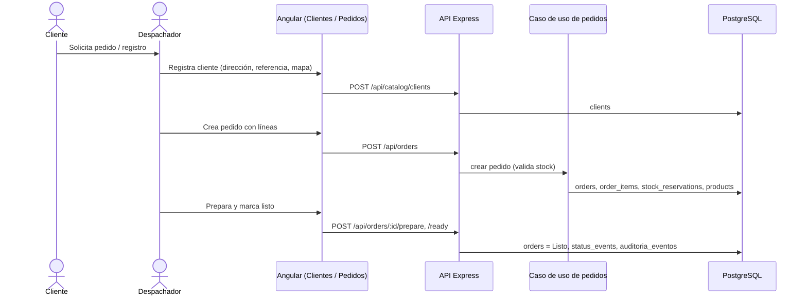

# Proceso 1 — Gestión de solicitudes de reparto

**Responsable:** Maria Magdalena Villegas Huamani
**Inicio:** el cliente solicita un pedido o registro.
**Fin:** pedido en estado `Listo`, con ubicación en mapa y stock reservado.

